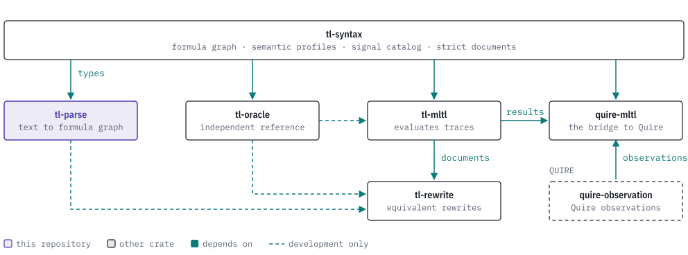

# tl-parse

[](https://discord.gg/k8DVhuYBR2)
[](#license)
[](Cargo.toml)

tl-parse turns Mission-time Linear Temporal Logic (MLTL) written as text, such as
`G[0,2](p0 -> F[1,1]p1)`, into a [tl-syntax](https://github.com/agent-ix/tl-syntax)
formula, and prints a formula back as canonical text. Malformed input comes back as
a diagnostic with a stable code and the byte span of the problem. It is a Rust
crate and a command-line tool.

You choose the dialect and the semantic profile. Parsing is bounded by limits on
source bytes, tokens, nodes, nesting depth and work, and parsing the canonical
output gives back the same graph.

<picture>
  <source media="(prefers-color-scheme: dark)" srcset="docs/images/hero-dark.svg">
   F[1,1]p1) and a semantic profile, closed, go into parse, which returns a FormulaDocument or a Diagnostic with one of 18 stable codes and a byte span. format_document turns the document into canonical text, G[0,2](p0->F[1,1]p1). Parsing that text again gives the same graph." src="docs/images/hero-light.svg">
</picture>

## Getting started

tl-parse is not on crates.io. Depend on it through git:

```toml
[dependencies]
tl-parse = { git = "https://github.com/agent-ix/tl-parse" }
```

Add `rev = "<commit>"` to pin a commit. It needs the Rust version in `rust-version` in `Cargo.toml`, or newer.

To install the command-line tool:

```sh
cargo install --git https://github.com/agent-ix/tl-parse --bin tl-parse
```

To build from a clone:

```sh
git clone https://github.com/agent-ix/tl-parse.git
cd tl-parse
cargo build --release
```

## Usage

This parses a formula, formats it to canonical text, and then parses an
inverted interval to show a diagnostic.

```rust
use tl_parse::{format_document, parse, DiagnosticCode, FormatLimits, ParseLimits};
use tl_parse::tl_syntax::SemanticProfile;

let report = parse(
    "G[0,2](p0 -> F[1,1]p1)",
    SemanticProfile::ClosedTraceV1,
    ParseLimits::default(),
);
assert!(report.diagnostics.is_empty());
let document = report.document.expect("the source parses");
let formatted = format_document(&document, FormatLimits::default());
assert_eq!(formatted.text.as_deref(), Some("G[0,2](p0->F[1,1]p1)"));

let refused = parse("p0 U[3,1] p1", SemanticProfile::ClosedTraceV1, ParseLimits::default());
assert!(refused.document.is_none());
assert_eq!(refused.diagnostics[0].code, DiagnosticCode::InvalidInterval);
assert_eq!(refused.diagnostics[0].span.start(), 4);
```

The command-line tool does the same from a shell:

```sh
printf 'p0 U[1,2] true' | cargo run --bin tl-parse -- format --profile online -
```

More examples, including the other dialects, are in
[docs/examples.md](docs/examples.md).

## Reference

| Dialect | Identity | Adds | Entry points |
| --- | --- | --- | --- |
| v1 | `tl-parse.clean-ascii/v1` | Boolean operators and the bounded future operators `F`, `G`, `U`, `R`. | `parse`, `format_document`, `format_formula` |
| v2 | `tl-parse.clean-ascii/v2` | The derived operators `W` and `M`, lowered to primitive nodes. | `parse_clean_ascii_v2` |
| v3 | `tl-parse.clean-ascii/v3` | The past operators `O`, `H`, `Y`, `S`, `T`. | `parse_clean_ascii_v3`, `format_clean_ascii_v3` |
| v4 | `tl-parse.clean-ascii/v4` | Unbounded intervals `[a,)`, past and future operators together, and a `fair {...}:` envelope. | `parse_clean_ascii_v4`, `format_clean_ascii_v4` |

The pages in [docs/](docs/index.md) describe each dialect, the command-line tool
and the diagnostics.

| Item | What it holds |
| --- | --- |
| `ParseReport` | Result of `parse`: dialect, profile, limits, statistics, optional document, diagnostics. |
| `Diagnostic`, `DiagnosticCode` | A located refusal and its 18 stable codes. |
| `ParseLimits`, `FormatLimits` | Caller limits, clamped to hard maxima. |
| `parse_with_context` | Parses, then binds each proposition to a shared signal catalog. |
| `PastParseReport`, `InfiniteParseReport` | Reports with strict canonical JSON readers. |

## The TL stack

tl-parse is the front end of the family: it reads text into the types that tl-syntax defines.

<picture>
  <source media="(prefers-color-scheme: dark)" srcset="docs/images/tl-stack-dark.svg">
  
</picture>

## Building and testing

```sh
make test          # cargo test --all-targets --all-features
make conformance   # replay corpus/v1 through the crate
make roundtrip     # parse-format-parse sweep
make fuzz-smoke    # bounded cargo-fuzz run over the checked-in seeds
make ci            # every local gate, including format, clippy, deny, spec, MSRV and rustdoc
```

The hostile-input corpus is in `corpus/` and the fuzz package is in `fuzz/`.

## Contributing

Read [CONTRIBUTING.md](CONTRIBUTING.md) and [CLA.md](CLA.md). The change history is in
[CHANGELOG.md](CHANGELOG.md).

## License

Licensed under either of [Apache License, Version 2.0](LICENSE-APACHE) or the
[MIT license](LICENSE-MIT) at your option.
