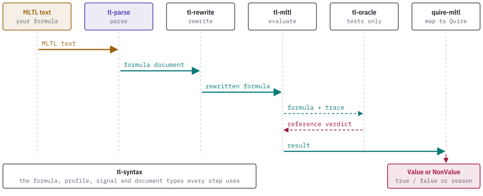

# How it works

## From text to a document

A parse runs three stages over the source string.

1. The lexer splits the text into tokens under the selected dialect. It accepts only the closed vocabulary of that dialect: `false`, `true`, propositions written `p` followed by a canonical unsigned decimal, the operators, brackets, parentheses and ASCII whitespace. Any other character or identifier is a diagnostic.
2. The parser builds tl-syntax nodes directly, using the binding powers of the dialect. Every node carries a half-open byte span into the source.
3. The finished node table is admitted through tl-syntax. A result is a `FormulaDocument` that has passed the tl-syntax validator, so every document the parser returns is also valid for the other TL crates.

A report holds either a document or diagnostics. When any diagnostic is raised, including a resource diagnostic, the document is withheld. The parser continues after most errors by skipping a token or treating a missing token as inserted, so one parse can report several diagnostics; each records the recovery it took.

The caller chooses the dialect by calling one of four entry points and chooses the semantic profile by argument. Nothing in the text selects either.

## Canonical text

`format_document` renders a document as canonical text: no whitespace, the spellings of the dialect, and parentheses only where removing them would change the tree. Prefix operands are parenthesized only when they are infix expressions. `format_clean_ascii_v3` and `format_clean_ascii_v4` do the same for the past and infinite-trace dialects, and `format_formula` takes a borrowed tl-syntax `Formula`.

Formatting is iterative and bounded, so deep graphs do not exhaust the stack. A graph that cannot be written in the dialect, or that exceeds the output limits, returns a `FormatError` and no text.

Parsing canonical text yields a graph with the same profile, root and node kinds as the document it came from. Source spans differ, because the text is different. `examples/roundtrip_sweep.rs` checks this over 20,000 generated sources per profile by default, and also removes parentheses from canonical text to confirm that the check can fail.

## Bounds

Every parse and format call takes limits. `ParseLimits` bounds source bytes, tokens, nodes, nesting depth, retained diagnostics and parser work. `FormatLimits` bounds output bytes and formatter work. Callers can lower each value and cannot raise it past a hard maximum; the effective values are recorded in the report. The values and the diagnostics they raise are in [diagnostics.md](diagnostics.md).

## Reports and strict readers

Each dialect has its own report type with a schema identity. `ParseReport` (v1) serializes with `report_json`. `DerivedParseReport` (v2) adds the lowering records. `PastParseReport` (v3) and `InfiniteParseReport` (v4) have `from_json_bytes`, a strict reader that takes `ParseArtifactLimits` and refuses unknown or duplicate fields, trailing data, non-canonical JSON, wrong identities, counters or spans that do not fit the report, and invalid embedded documents. `parse_with_context` returns a `ContextualParseReport` that binds each free proposition to a signal in a shared tl-syntax signal catalog.

## Where the crate sits

A formula passes through several crates on its way from text to a Quire outcome. tl-parse is the first stage.

<picture>
  <source media="(prefers-color-scheme: dark)" srcset="images/pipeline-dark.svg">
  
</picture>

The calling program moves documents from one stage to the next. The dependency structure between the crates is in the [README](../README.md#the-tl-stack).

## A worked example

tl-parse answers the first question in a debugging session: does the requirement text become the formula the engineer meant? The requirement in the worked example is `F[0,3] p2`, a deadline that signal `s2` must hold at some instant from 0 through 3. Every later stage works on the document tl-parse produces here.

<picture>
  <source media="(prefers-color-scheme: dark)" srcset="images/scenario-sequence-dark.svg">
  
</picture>

At this step, check that the document matches the requirement. `format` prints the canonical text, and it should read back as the requirement. `validate --json` prints the document, and the `future` node should carry the interval `{"start":0,"end":3}`. An interval parsed as `[0,2]` changes the verdict at a later stage, and nothing downstream can repair it.

```text
$ printf 'F[0,3] p2' | tl-parse format --profile online -
F[0,3]p2

$ printf 'F[0,3] p2' | tl-parse validate --profile online --json - | python3 -c "import json,sys; d=json.load(sys.stdin); print(json.dumps(d['document']['nodes'])); print(d['diagnostics'])"
[{"kind": "proposition", "proposition": 2, "span": {"start": 7, "end": 9}}, {"kind": "future", "interval": {"start": 0, "end": 3}, "operand": 0, "span": {"start": 0, "end": 9}}]
[]
```

Node 0 is proposition 2 and node 1 is a `future` node over node 0. The `diagnostics` list is empty.

A malformed requirement returns no document. Each problem has a code and a byte span. Here the upper bound is missing:

```text
$ printf 'F[0,] p2' | tl-parse validate --profile online -
error[unexpected_token] 4..5: expected interval end integer, found "]"
error[trailing_input] 6..8: unexpected trailing token "p2"; expected end of input
$ echo $?
1
```

The first diagnostic points at the `]` where an integer was expected. The second follows from the first, because the parser recovered by skipping a token. Fix the first diagnostic and rerun before reading the others.

The later stages are in the [worked example in tl-mltl](https://github.com/agent-ix/tl-mltl/blob/main/docs/scenario.md).
